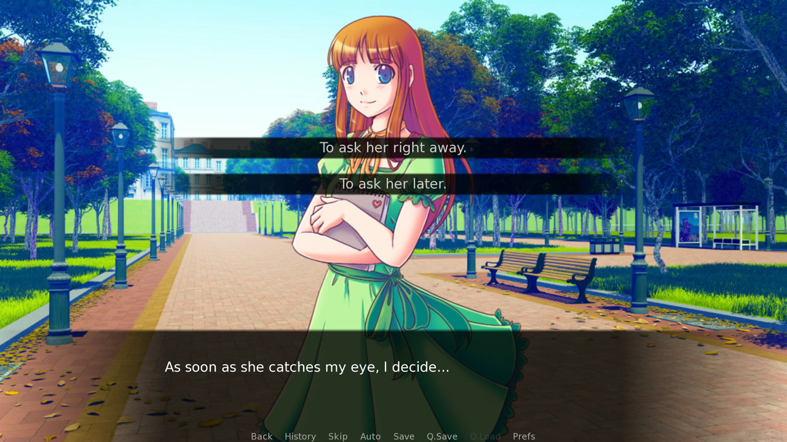
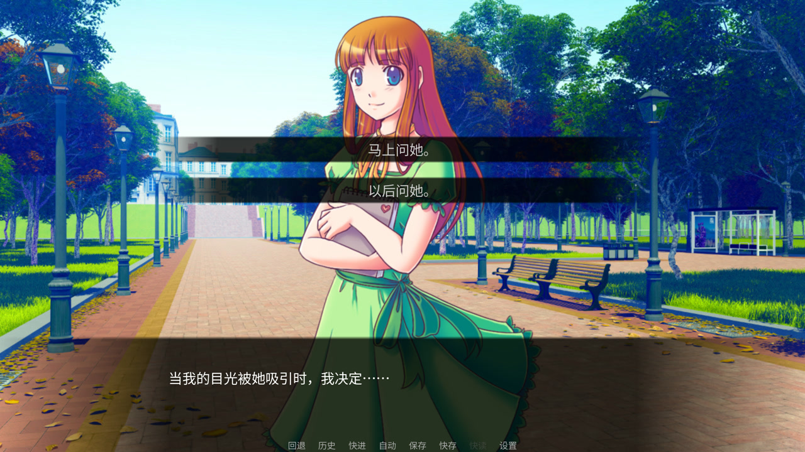
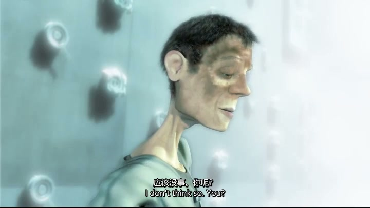

# hanhua 游戏与影视汉化

<div align="center"> <a href="LICENSE"></a>  </div>

给 Codex 一个 Windows 本地路径。输入游戏目录，可以生成可还原的简中补丁，或在游玩时显示画面和对白的中文字幕。输入电影或整季剧集，可以得到保留原声、带普通话配音及双语字幕的 MKV。

[实际效果](#实际效果) ｜ [安装](#安装) ｜ [在 Codex 中使用](#在-codex-中使用) ｜ [命令行](#命令行) ｜ [支持范围](#支持范围) ｜ [许可证](#许可证)

## 实际效果

### 游戏《The Question》

同一处剧情选择，左图是还原补丁后首次启动的英文画面，右图是安装补丁后的中文画面。选项、对白和底栏都由 Ren’Py 实际渲染。

| 英文 | 简体中文 |
| :---: | :---: |
|  |  |

这个 Ren’Py 8.5.3 示例自带简中。为了同时验证复用和补译，测试副本留空了两句开场对白。技能沿用已有选项和人物译名，并补齐这两句。实机走完了三条选择路径和两个结局，还原后 168 个原文件的 SHA-256 全部一致，汉化前后创建的两份存档都能继续读取。[对照补译的开场对白](https://gpddev.github.io/hanhua/#game-dialogue)

### 电影《Elephants Dream》

下面是普通话成片第 7.75 秒的画面。点击图片可以播放，在同一时间点切换英语原声和普通话，比较对白和背景音。

[](https://gpddev.github.io/hanhua/#movie)

**[在线播放原声与普通话](https://gpddev.github.io/hanhua/#movie)** ｜ [下载双音轨 MKV](https://raw.githubusercontent.com/GPDdev/hanhua/main/docs/demo/elephants-dream-zh.mkv) ｜ [简中 SRT](docs/demo/elephants-dream.zh-Hans.srt) ｜ [双语 ASS](docs/demo/elephants-dream.bilingual.ass)

输入是原片 00:45 至 01:08 的 23 秒无字幕片段。技能听出 7 句英语对白，由 Codex 翻译，随后分离背景音、合成普通话并封装。MKV 默认播放普通话并显示双语字幕，可手动切回英语或单语字幕。预览和下载件都保留了本次 OCR 的实际结果，在约第 6、8、13 秒各有一处画面纹理被误识为字母。[素材来源与署名](docs/demo/CREDITS.md)

## 安装

在 64 位 Windows 上使用。已在 Windows 11 x64 实测。准备好 Codex 和 Git，再打开 PowerShell。

1. 安装 **uv**，或准备带 `py` 启动器的 **Python 3.11**。处理影视、音频资源和实时字幕时，还需让 `ffmpeg` 和 `ffprobe` 在终端里可用。若电脑使用 WinGet，可用以下命令安装 uv 和 FFmpeg，然后重新打开 PowerShell。

   ```powershell
   winget install --id astral-sh.uv -e
   winget install --id Gyan.FFmpeg -e
   ```

2. 克隆本仓库并运行安装脚本。

   ```powershell
   git clone https://github.com/GPDdev/hanhua.git
   Set-Location .\hanhua
   powershell.exe -NoProfile -ExecutionPolicy Bypass -File .\install.ps1
   ```

   也可以[下载 ZIP](https://github.com/GPDdev/hanhua/archive/refs/heads/main.zip)，解压后在有 `install.ps1` 的目录执行最后一行。脚本会打印安装目录，默认为 `%USERPROFILE%\.codex\skills\hanhua`。设置了 `CODEX_HOME` 时会装到该目录的 `skills\hanhua`。

3. 打开新的 Codex 对话，输入 `$hanhua` 和本地路径。首次运行会创建独立 Python 3.11 环境，并联网获取该任务所需的工具或模型。默认缓存目录为 `%LOCALAPPDATA%\hanhua`。Codex 会话负责翻译时无需另配翻译 API 密钥；终端全自动模式和实时字幕另需本机安装 [Ollama](https://ollama.com/download/windows)。

更新时，在克隆目录执行 `git pull --ff-only`，再运行一次 `install.ps1`。用 ZIP 安装的用户可解压新版后重跑安装脚本。

## 在 Codex 中使用

将示例路径换成自己的路径，每次发送一条即可。

```text
$hanhua 汉化 "D:\Games\Example"，生成简中补丁。
$hanhua 给 "D:\Games\Example" 安装刚生成的补丁。
$hanhua 还原 "D:\Games\Example" 的汉化补丁。
$hanhua 为正在运行的 "D:\Games\Example" 开启日语画面和对白的实时中文字幕。
$hanhua 汉化 "D:\Movies\Example.mkv"。
$hanhua 汉化 "D:\Series\Season 01" 里的整季剧集。
```

| 输入 | 去哪里找结果 |
| --- | --- |
| 游戏目录 | 默认在同级的 `Example.hanhua`。有可写入的资源时，`patch-…\patch.json` 是安装和还原用的清单。`live.cmd` 用于实时字幕。 |
| 单部电影 | 例如 `Example.mkv.hanhua`，里面有 `Example.zh-Hans.mkv`、`Example.zh-Hans.srt` 和 `Example.bilingual.ass`。可在播放器的音轨和字幕菜单切换。 |
| 剧集目录 | 每集有独立输出，共用术语和已提交的译文。中断后用原输入和原输出目录重跑，即可续接。 |

每个成品的 `report.json` 记录实际处理结果。游戏报告列出补丁覆盖和未处理的资源，影片报告列出对白来源和所用混音方式。输出位置也会打印在终端，可用 `--out` 指定到输入目录之外。

## 命令行

下面的 PowerShell 命令在克隆目录运行。无人值守的 `run` 使用本机 Ollama。可以用 `HANHUA_MODEL` 指定模型；若未指定且模型库为空，程序会尝试下载 `qwen2.5:3b`。

```powershell
$env:HANHUA_MODEL = "qwen2.5:3b"
powershell.exe -NoProfile -ExecutionPolicy Bypass -File .\hanhua.ps1 run "D:\Movies\Example.mkv"
```

| 子命令 | 用途 |
| --- | --- |
| `prepare <输入>`、`next <输入> --limit 48` | 探测作品，按批取出原文、ID、角色和上下文。 |
| `submit <输入> --file <译文.json>`、`build <输入>` | 提交 UTF-8 JSON 对象，键为原 ID，值为简中译文。全部译完后构建成品。 |
| `apply <patch.json>`、`restore <patch.json>` | 安装、还原游戏补丁，两者都会检查哈希。移动了安装目录时可追加 `--game <新目录>`。 |
| `live --list`、`live --pid <PID> --lang ja` | 列出窗口，再对选中的游戏开启实时字幕。F10 隐藏或显示字幕，F12 退出。 |

## 支持范围

| 类型 | 当前验证范围 |
| --- | --- |
| Ren’Py | 《The Question》实机验证了菜单、对白、分支、存档及还原。主版本不同的作品可用 `HANHUA_RENPY_SDK` 指定兼容 SDK。 |
| Godot | 在 Godot 4.4.1 中实际运行 CSV、普通 gettext PO 和键式 PO 本地化工程。 |
| RPG Maker、Unity、Unreal | 分别验证了 MV/MZ 的事件和数据库 JSON、Unity 资源文件及 UnityFS 包里的文本 TextAsset、Unreal 松散的 v0 至 v3 `.locres`。商业发行版的打包、字体和加载效果需按作品检查。 |
| 实时字幕 | 分别捕获游戏窗口文字和目标进程的对白。可捕获性取决于窗口模式和系统；独占全屏可尝试切换为无边框窗口。 |
| 电影、剧集 | 支持 MKV、MP4、MOV、WebM 等常见本地视频，以及同名的 SRT、ASS、SSA、VTT 字幕。缺原文字幕时听译对白，同时识别画面文字。配音优先用已有普通话或独立音乐音效轨，也可分离混合音轨；分离质量不足时会压低原声、叠加中文旁白。 |

陌生游戏格式可以在工作副本上试作适配，验证译文能被游戏或格式读取器读回后再构建补丁。更多操作见[游戏处理](references/games.md)和[影视处理](references/movies.md)。

## 参与改进

报告兼容性问题时，请给出引擎或视频格式、系统版本、复现步骤，以及 `report.json` 中相关条目。修改适配器后，可在仓库根目录用已安装依赖的 Python 3.11 运行回归检查。

```powershell
python -m unittest discover -s tests -p "test_*.py"
```

## 许可证

本项目源代码采用 [MIT 许可证](LICENSE)。游戏画面与电影片段各有原作者和授权条款，模型及外部工具沿用各自的许可证。[演示素材署名与使用条件](docs/demo/CREDITS.md)
